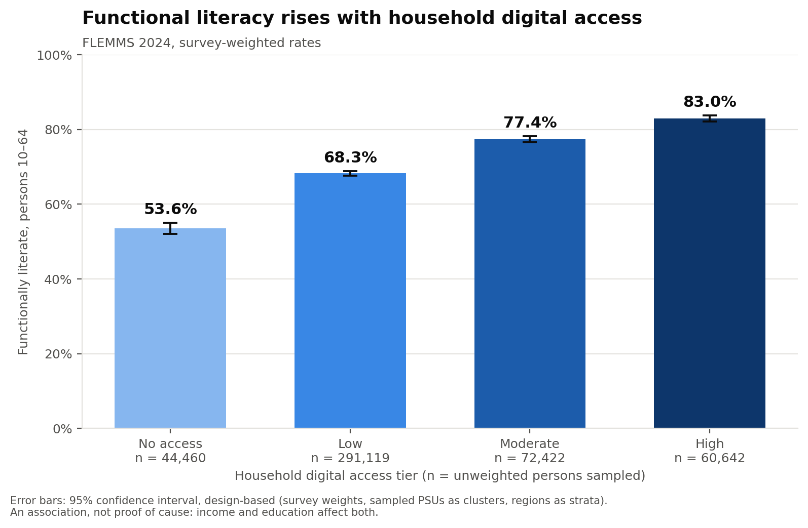
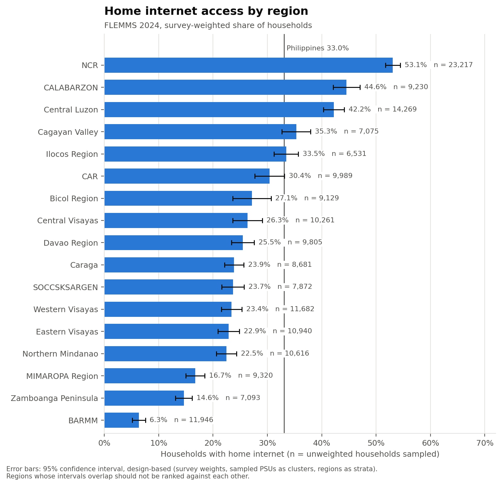
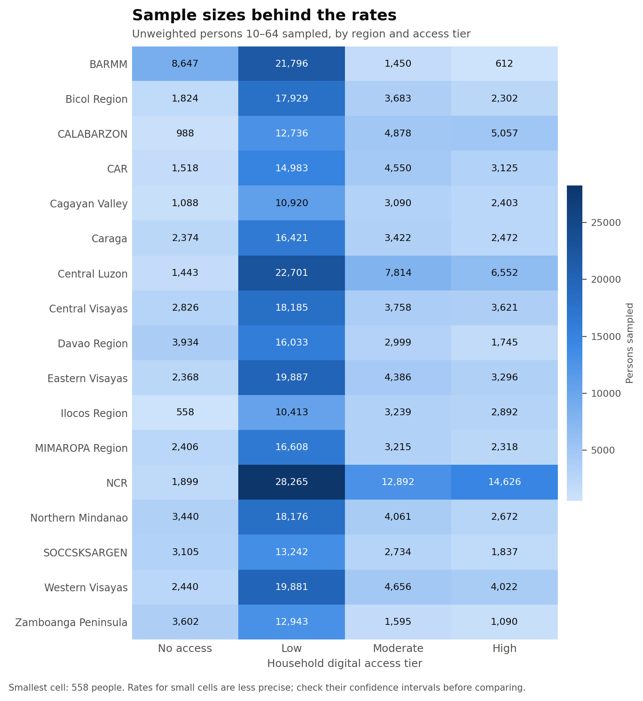

# What the findings show

*Interpretation of the survey estimates and charts, by Claudia Martin, Data Scientist.*

All numbers come from `outputs/analysis/key_estimates.csv`, produced by the pipeline's
`estimate_key_indicators` task. Each rate is survey-weighted, with a design-based 95% confidence
interval (CI) and the unweighted number of people or households it rests on (n).

## 1. Digital access and functional literacy

| Digital access tier | Functional literacy, persons 10-64 |
|---|---|
| No access | 53.6% (95% CI 52.0 – 55.1, n = 44,460) |
| Low | 68.3% (95% CI 67.7 – 68.9, n = 291,119) |
| Moderate | 77.4% (95% CI 76.6 – 78.2, n = 72,422) |
| High | 83.0% (95% CI 82.1 – 83.8, n = 60,642) |
| **All persons 10-64** | **70.8% (95% CI 70.2 – 71.3, n = 468,643)** |

Functional literacy rises at every step of digital access, and the rise is not sampling noise: no two neighbouring tiers have overlapping intervals (for example, "No access" tops out at 55.1% while "Low" starts at 67.7%). The gap between households with no access and households with high access is 29.4 percentage points (53.6% vs 83.0%), which is large compared with intervals that are only 1 to 3 points wide. What we cannot conclude is that digital access causes literacy. This is a one-time survey, and household income and education level affect both how many devices a household can afford and how well its members read and compute. The finding is an association: people in better-connected households are much more likely to be functionally literate.

## 2. Home internet by region

| Region | Households with home internet |
|---|---|
| NCR | 53.1% (95% CI 51.7 – 54.4, n = 23,217) |
| CALABARZON | 44.6% (95% CI 42.1 – 47.0, n = 9,230) |
| Central Luzon | 42.2% (95% CI 40.3 – 44.1, n = 14,269) |
| Cagayan Valley | 35.3% (95% CI 32.7 – 38.0, n = 7,075) |
| Ilocos Region | 33.4% (95% CI 31.2 – 35.7, n = 6,531) |
| CAR | 30.4% (95% CI 27.7 – 33.1, n = 9,989) |
| Bicol Region | 27.1% (95% CI 23.6 – 30.7, n = 9,129) |
| Central Visayas | 26.3% (95% CI 23.6 – 29.1, n = 10,261) |
| Davao Region | 25.5% (95% CI 23.4 – 27.6, n = 9,805) |
| Caraga | 23.9% (95% CI 22.1 – 25.6, n = 8,681) |
| SOCCSKSARGEN | 23.7% (95% CI 21.6 – 25.7, n = 7,872) |
| Western Visayas | 23.4% (95% CI 21.5 – 25.3, n = 11,682) |
| Eastern Visayas | 22.9% (95% CI 20.9 – 24.8, n = 10,940) |
| Northern Mindanao | 22.5% (95% CI 20.6 – 24.3, n = 10,616) |
| MIMAROPA Region | 16.7% (95% CI 15.0 – 18.5, n = 9,320) |
| Zamboanga Peninsula | 14.6% (95% CI 13.1 – 16.2, n = 7,093) |
| BARMM | 6.3% (95% CI 5.1 – 7.6, n = 11,946) |
| **Philippines** | **33.0% (95% CI 32.4 – 33.7, n = 177,656)** |

Some differences are clear. NCR (53.1%) is above every other region, BARMM (6.3%) is far below every other region, and CALABARZON and Central Luzon are clearly above the regions that follow them. Inside the groups, however, the intervals overlap, so those regions should not be ranked against each other: CALABARZON and Central Luzon; Cagayan Valley, Ilocos and CAR; the large middle group from Bicol (27.1%) down to Northern Mindanao (22.5%); and MIMAROPA and Zamboanga Peninsula. For a connectivity programme such as DICT's, BARMM is the obvious place to start, followed by Zamboanga Peninsula and MIMAROPA. Among the eight middle regions the data cannot say which is worse off, so the order there should be decided by other criteria such as population or installation cost.

## 3. Functional literacy by region

| Region | Functional literacy, persons 10-64 |
|---|---|
| CAR | 81.2% (95% CI 79.6 – 82.7, n = 24,176) |
| NCR | 79.9% (95% CI 78.5 – 81.3, n = 57,682) |
| CALABARZON | 77.3% (95% CI 75.6 – 79.0, n = 23,659) |
| Central Luzon | 73.0% (95% CI 71.2 – 74.8, n = 38,510) |
| MIMAROPA Region | 70.7% (95% CI 68.7 – 72.7, n = 24,547) |
| Northern Mindanao | 70.0% (95% CI 67.7 – 72.3, n = 28,349) |
| Cagayan Valley | 69.4% (95% CI 67.0 – 71.7, n = 17,501) |
| Central Visayas | 68.3% (95% CI 65.7 – 70.8, n = 28,390) |
| Western Visayas | 67.6% (95% CI 65.7 – 69.5, n = 30,999) |
| Bicol Region | 67.0% (95% CI 65.3 – 68.7, n = 25,738) |
| Davao Region | 66.7% (95% CI 64.7 – 68.7, n = 24,711) |
| SOCCSKSARGEN | 65.8% (95% CI 63.6 – 68.0, n = 20,918) |
| BARMM | 64.7% (95% CI 61.9 – 67.5, n = 32,505) |
| Ilocos Region | 64.3% (95% CI 61.6 – 66.9, n = 17,102) |
| Caraga | 63.1% (95% CI 61.2 – 65.1, n = 24,689) |
| Eastern Visayas | 61.8% (95% CI 60.1 – 63.6, n = 29,937) |
| Zamboanga Peninsula | 59.3% (95% CI 56.7 – 61.9, n = 19,230) |

Zamboanga Peninsula is low on both measures: it has the lowest functional literacy (59.3%, close to Eastern Visayas and Caraga) and the second-lowest home internet (14.6%). That makes it a double priority, because its residents lack both the devices and connection and the reading and comprehension skills to get full value from them, so a programme that only adds connectivity, or only adds schooling, would solve half of the problem. CAR shows the opposite pattern: it has the highest literacy (81.2%, statistically tied with NCR) but only 30.4% home internet, around or slightly below the national 33.0%. This shows that digital access is only one factor among several; schooling and other local conditions can produce high literacy even where connectivity is limited.

## 4. How precise are these numbers?

Facts: the smallest region × tier group has 558 people; the national rate is 70.8% ± 0.5 points;
design effects are 7–13 for the tiers and 9–28 for regions
(a design effect of 10 means the survey is as precise as a simple random sample one-tenth its size).

The design effects are large because FLEMMS does not pick people at random from the whole country: it samples areas first and then interviews many households in each area, and neighbours tend to be similar in income, schooling and internet availability. Each extra person from the same area therefore adds less new information than a randomly chosen person would, so a sample of hundreds of thousands behaves like one of only tens of thousands. Because of this, a planner should look at the interval and not only at the rate: two regions a few points apart can easily swap places in another sample, and ranking them by the point estimate alone could send resources to the wrong region.

## 5. Limitations

- **Association, not causation.** The survey is a single snapshot, and income and education influence both digital access and literacy, so we cannot say that giving a household internet would raise its literacy.
- **Household-level access.** Digital access is measured per household, so every member gets the same tier; a child and a grandparent in a connected home may use the internet very differently.
- **Slightly wide intervals.** The public-use file has no stratum variable, so the intervals treat regions as strata. They are therefore slightly wider (more conservative) than PSA's own would be, which means real differences may be a little more certain than we report, not less.
- **Our own access score.** The digital access tiers and their cut-offs are our business rule, not a PSA indicator; another definition would give different tier sizes, although literacy rises at every score from 0 to 5.
